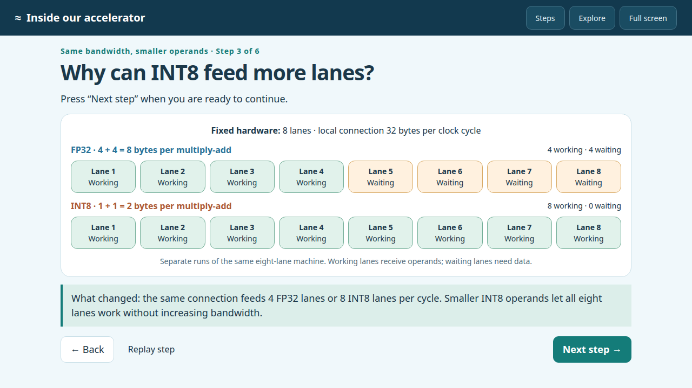

# Visual walkthrough

An interactive companion to the notebooks and presentation. It connects the
numbers, proposed hardware, digit predictions, and memory limits in one place.

**[Start with the launchers](../ONE-CLICK-LAUNCHERS/README.md).** They handle setup
and open a local browser page on Windows, macOS, Linux, or WSL.



## Use alongside the PowerPoint

Select **Start demo** for six short visual stops. The highlighted button names the
next action; the result explains what changed. **Next step** moves on. **Back**
revisits a stop, and **Replay step** starts its actions again.

| Stop | Buttons to press | What it shows |
|---|---|---|
| 1 · Smaller numbers | **Convert 1.23** | Rounding stores 12 at scale 0.1 and reconstructs 1.2. |
| 2 · Clock cycles | **Next clock cycle**, six times | Load inputs, load weights, three multiply-adds, and store 29. |
| 3 · Same bandwidth, smaller operands | **Run FP32**, then **Switch to INT8** | At the same 32 bytes/cycle, four FP32 lanes or all eight INT8 lanes receive their operands. |
| 4 · One real image | **Inspect this pixel** → **Show the first-layer calculation** → **Prepare the hidden values** → **Show the ten scores** → **Highlight the largest score** | Follow the trained network before revealing its prediction. |
| 5 · Performance | **Compare FP32 and INT8** | Matched matrix-stage cycles and their compute/transfer breakdown. |
| 6 · Memory fit | **Use a 64 KiB buffer** | INT8 fits; FP32 does not fit this untiled model. |

Stop 3 holds the calculation, eight physical lanes, and all hardware settings fixed.
Only the operand format changes: At our baseline 32 bytes/cycle, FP32 needs 4 + 4 bytes per multiply-add; INT8 needs
1 + 1. The two rows are separate runs of the same machine. More INT8 lanes can work
per compute cycle because their operands use fewer bytes. Custom bandwidth changes
remain available in Explore and the optional waiting-lanes explanation.

Use **Steps** to jump to a topic when it supports the current slide. For a short
presentation insert, use stop 2 with slide 7 (six clock cycles) and stop 3 with
slide 11 (lanes waiting for data). Stop 4 supports slide 8's real-value checks;
stop 5 supports slide 10's cost comparison. These are visual pauses within the
existing talk. Budget their time during rehearsal; running every stop is optional.
The PowerPoint and its submitted speaker notes are unchanged.

**Steps → Extra explanations** holds clipping, wide totals, bias/rescaling,
and disagreement examples. **Explore** opens the full controls, 31-image gallery,
raw scores, hidden values and sweep charts. **Return to demo** restores the same
lesson and result; Explore keeps its own settings. The finish screen gives a clear
return point to the PowerPoint without opening or focusing another application.

**Full screen** uses the browser's full-screen mode. Keyboard activation works on
buttons; right/left arrow keys act/go back when focus is outside controls.
The animation advances only when requested. Reduced motion still supports stepping.

## What the results mean

- Toy animation frames come from actual scheduling events. Playback speed changes
  the animation speed, not the modeled clock or cycle counts.
- Selecting a digit runs both matrix layers with its actual values. Independent
  numerical checks compare the scalar simulator with NumPy reference arithmetic.
  Image 8 is a useful example: the known digit is 5 and both models predict 6,
  even though the arithmetic checks pass.
- The gallery has **31 selected test images**: the original first 16 plus all
  15 FP32/INT8 disagreements. It is chosen to explain behavior, not estimate accuracy.
  The accuracy cards are the saved **10,000-image** result: 96.96% FP32 and 96.98% INT8.
- Training learned the weights. A separate 1,000-image calibration set selected
  the hidden scale before testing; that scale stays fixed while presenting.
  The demo does not learn from its gallery or adjust scales when images change.
- Integer bias, ReLU, and rescaling are calculated. They are outside the timing
  estimate, along with argmax, control, preprocessing, and bias/scale traffic.
  Final integer scores remain INT32; chart unit conversion is only for display.
- Hardware controls rerun the same scheduling rules with matched FP32/INT8
  settings. Baseline matrix stages take **19,204 / 8,025 cycles (2.393×)**.
  Changing the assumed clock changes time, not cycle counts. This is a high-level
  proposed accelerator, with no measured chip, power, or area result.
- Layers must fit in local memory. A failing configuration is shown as unavailable;
  tiling, overlapping transfers, broadcast reuse, and extra timing stages are not modeled.

## Setup help

The launchers find Python 3.10–3.14, create an isolated environment, install the
pinned NumPy version, and choose an available local port. Python 3.10–3.12 uses
NumPy 1.26.4; Python 3.13–3.14 uses NumPy 2.4.6.

Windows stores setup under `%LOCALAPPDATA%\QNNDemo\` to avoid long-path problems.
macOS/Linux/WSL use ignored `.demo-venv/` inside the repo. Environments are separated
by operating system and Python version. None changes the system's Python packages.
After moving a repo, rerun the launcher; it can recreate setup. To repair a broken
environment, remove only its demo environment directory and launch again.

On Debian/Ubuntu, a missing `venv`/`ensurepip` message usually needs the matching
`python3-venv` package installed first. A failed dependency installation needs an
internet connection and another launch. First setup should be done before class.

An already-configured Python can also run the app directly:

```sh
python -m pip install -r demo/requirements.txt
python -m demo --open --port 0
```

`--port 0` picks an available port; a fixed port such as `--port 8001` also works.
Use the launcher's `--no-browser` option when opening the address manually.
The app listens only on `127.0.0.1` and serves its own page and calculation routes.
Closing its terminal stops the server; closing the browser tab alone does not.

## Checks and provenance

```sh
python ONE-CLICK-LAUNCHERS/launch_demo.py --check
```

This sets up and runs the calculation, asset, HTTP, and launcher checks without
opening a browser. Developers can run `python -m unittest discover -s demo/tests -v`
in an environment with the runtime dependency installed.

The optional browser checks need Playwright and its Chromium browser, installed
in the same development environment:

```sh
python -m pip install -r demo/requirements.txt -r demo/requirements-dev.txt
python -m playwright install chromium
python -m demo.tests.browser_check
```

The browser checks block external requests and exercise playback, inference stages,
bad-setting recovery, the six presentation stops and optional explanations, and desktop/projector/mobile layouts.
With their default local server, backend connections are restricted to loopback too.
`--url http://127.0.0.1:PORT` checks an existing server; `--screenshots PATH` saves
actual browser captures. These tools are not required for presenting.

Verification on November 20, 2026: the redesigned app passes 28 calculation,
asset, HTTP and launcher checks on Linux/WSL Python 3.12. Headless Chromium checks
cover every presentation action, optional explanation, error recovery, keyboard
navigation, Explore/return, laptop/projector/mobile layouts and enlarged content.
The unchanged launchers were previously checked on native Windows Python 3.11/3.13.
The macOS launcher shares the POSIX script but has not been run on a Mac.

`runtime.py` preserves the numerical and scheduling definitions from notebooks
03 and 05; tests check notebook parity and the published timing sweeps.
`assets/metadata.json` records source results, scales, hashes, selected image IDs,
and expected predictions. Asset fingerprints are checked when the app starts.

Bundle preparation rebuilt calibrated integer weights from the verified FP32
weights and reproduced both published full-test prediction hashes before selecting
the 31 images. This one-time preparation is separate from normal launches.
To rebuild, `python -m demo.prepare_assets` downloads checksum-verified MNIST
archives as needed into the ignored cache and checks the full test set again.
Optional `--retrain` repeats notebook 05's training recipe. Use the reference
Python 3.12 / NumPy 1.26.4 environment for this reproduction step.

The submitted report, slides, notebooks, and result exports are retained as published.
