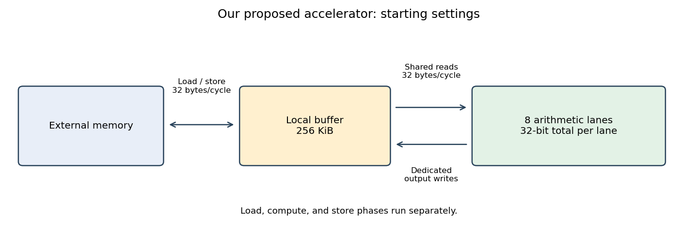
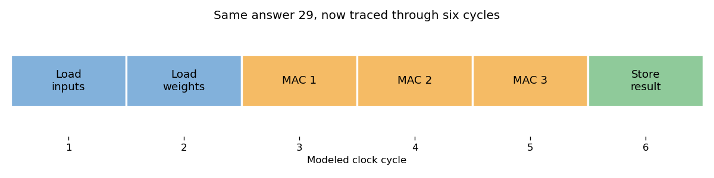
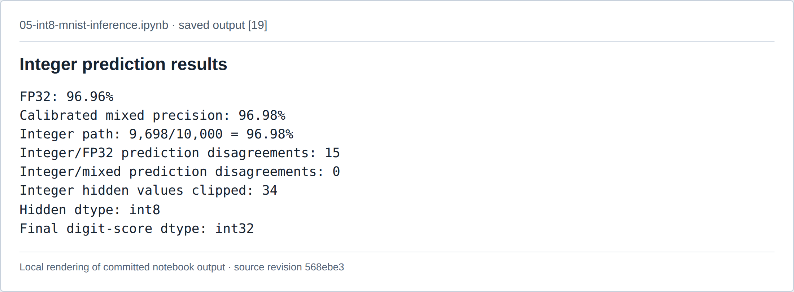
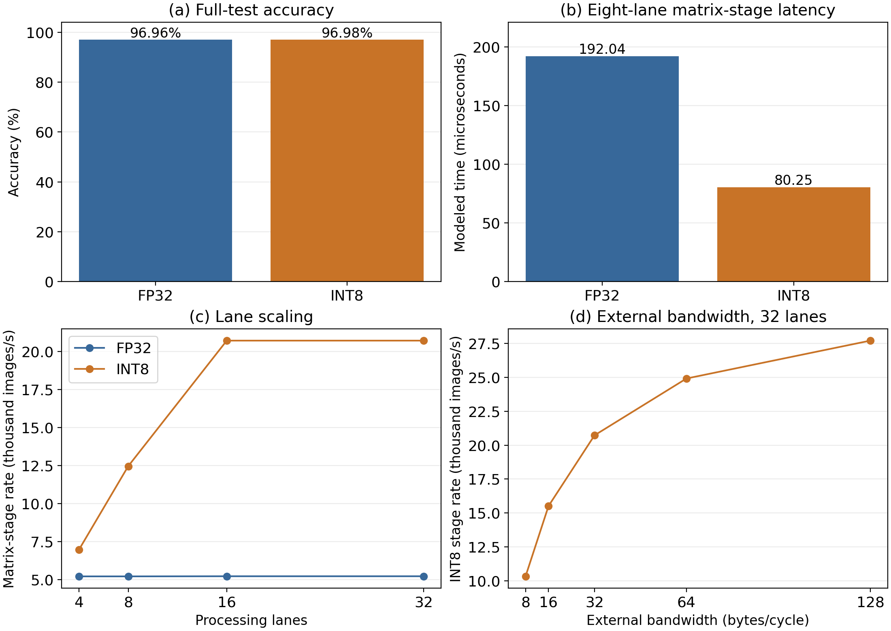

# Introduction

Neural-network inference repeatedly multiplies inputs by learned weights and adds the products. Representing every operand as a 32-bit floating-point value (FP32) consumes storage and bandwidth. Eight-bit integers (INT8) offer smaller operands, but rounding, clipping, and scale conversion can change predictions. The architecture question is whether these smaller numbers reduce execution costs enough to justify their numerical and implementation tradeoffs.

This project proposes and implements a high-level matrix accelerator and evaluates FP32 against INT8 on a handwritten-digit recognition network. The design has configurable processing lanes, local storage, local operand-read bandwidth, and external transfer bandwidth. A custom simulator performs the arithmetic while counting execution cycles. MNIST supplies the input images; a small NumPy network supplies the actual learned weights and predictions.

Under the baseline eight-lane assumptions, the two matrix stages require **19,204 FP32 cycles versus 8,025 INT8 cycles**, a **2.393x modeled speedup**. Full-test accuracy is **96.96% FP32 and 96.98% INT8**. These are separate observations: accuracy covers all 10,000 test images, while real-value simulator verification covers the first 16. Timing covers matrix computation and transfers, not complete inference. The implementation is a software architecture model; no physical device, synthesized clock, area, or power is claimed.

# Related Work and Your Contribution

**Brevitas** provides quantization tools for PyTorch and supports post-training quantization and quantization-aware training [\[1\]](https://xilinx.github.io/brevitas/v0.13.4/getting_started.html). Its examples distinguish quantized weights, activations, and biases. This informed our decision to specify ranges, zero points, scales, and bias units explicitly. Our implementation uses NumPy and our own arithmetic instead of running Brevitas. Our signed activation representation uses only 0–127 after ReLU, whereas the Brevitas tutorial illustrates unsigned ReLU quantization. Matching a broad quantization approach does not establish numerical equivalence.

**FINN** introduced a streaming FPGA architecture for binarized neural-network inference, and its current framework generates network-specific dataflow accelerators [\[2\]](https://arxiv.org/abs/1612.07119), [\[3\]](https://xilinx.github.io/finn/). FINN separates output parallelism through processing elements from input parallelism through SIMD. Its documented matrix-vector folding constraints require suitable divisibility by those parameters [\[4\]](https://github.com/Xilinx/finn/blob/38c42bf95abbdad493db0b0f5053060074698908/docs/finn/reference/folding-constraints.rst). Our lanes instead handle separate dot products, share one local read budget, and accept a partially filled final output group. The same engine serves the layers sequentially; it is not a reproduction of FINN's streaming implementation.

Jacob et al. demonstrate an integer-only inference approach with a corresponding training procedure [\[5\]](https://arxiv.org/abs/1712.05877). Our narrower experiment uses post-training quantization of one already-trained FP32 network. It studies a transparent numerical policy and a small architecture model, rather than reproducing published device benchmarks or claiming a new quantization algorithm.

Our contribution is the implemented combination of checked arithmetic, a cycle-stepped scheduler, a trained workload, and reproducible evaluation. It includes known-answer tests, INT32 bias conversion, integer activation rescaling, capacity and bandwidth accounting, exact integer verification through both simulated layers, and exported results that directly drive the graphs. Brevitas and FINN were consulted as design references; neither was installed or executed for these results.

# Methodology / Project Implementation

## Workload and data separation

Each MNIST image contains 28 by 28 grayscale pixels and a digit label from 0 to 9. We verify the downloaded archive checksums, decode the IDX records, divide pixel values by 255, and flatten each image to 784 inputs. The archive identities and mirror follow the published dataset loader information [\[6\]](https://github.com/pytorch/vision/blob/main/torchvision/datasets/mnist.py). Image-file decoding and preparation are outside accelerator timing.

The 60,000-image training archive is split reproducibly with seed 530:

| Group | Images | Use |
|---|---:|---|
| Training | 54,000 | Learn weights and biases |
| Validation | 5,000 | Monitor learning after each epoch |
| Calibration | 1,000 | Choose the intermediate INT8 scale after training |
| Separate test archive | 10,000 | Measure final prediction accuracy |

: Dataset groups and their separate roles.

The network is `784 → 64 → 10`, with ReLU between the two dense layers. Training uses an implemented NumPy Adam routine for eight epochs, batch size 128, learning rate 0.001, and seed 530. Inference chooses the largest of the ten output scores. Each image requires $784\times64+64\times10=50{,}816$ multiply-accumulates (MACs). The learned FP32 weights are held fixed when constructing the quantized versions. At epoch eight, the recorded training accuracy was 97.97% and validation accuracy was 97.16%; these monitor learning rather than accelerator performance.

Calibration uses only the reserved inputs, without their correct-answer labels. It observes the quantized first layer with floating-point bias and ReLU, chooses the largest observed nonnegative value divided by 127, and then freezes that scale. The same scale is retained when evaluating the integer path. Test inputs and labels do not configure quantization. Validation labels monitor training; test labels only grade predictions.

## Numerical representation

Weights use one symmetric scale per matrix, zero point 0, and range −127 through 127. For a value $v$ and positive scale $s$, quantization rounds $v/s$ with ties to even, clips to that range, and stores INT8. An all-zero weight matrix uses scale 1. Normalized input pixels use the known range 0–1 and fixed scale $1/127$, not a scale estimated from test images. ReLU outputs use the nonnegative subset 0–127.

For the archived run, the intermediate scale is **0.10185138071615865**, corresponding to a nonnegative maximum of approximately **12.935125**. The first and second weight scales are approximately 0.0055968630 and 0.0079521035.

A matrix product accumulates in INT32. Its bias must use the same units as that product:

$$b_q=\operatorname{round}_{\mathrm{even}}\left(\frac{b_{\mathrm{FP32}}}{s_{\mathrm{input}}s_{\mathrm{weight}}}\right).$$

The second-layer bias instead uses the product of the hidden and second-weight scales. Conversion occurs during setup. Bounds based on $127\sum_k |w_{kj}|$ and the bias reject layers that cannot be guaranteed to accumulate and add bias safely in INT32. The scalar simulator also checks each integer MAC.

The first layer's nonnegative biased total is rescaled to the fixed hidden scale using integer multiplier **464,594** and shift **30**. Setup approximates the scale ratio with $M/2^{30}$; prediction uses a checked INT64 multiplication, ties-to-even integer rounding, a shift, and clipping to 0–127. Hidden storage is INT8, and final scores remain INT32. Their shared positive output scale means the maximum integer score identifies the predicted digit without dequantization.

Floating point remains part of training, calibration, and normalized-pixel conversion at the input boundary. The integer prediction core starts with quantized pixels. NumPy uses INT32 products/accumulation for evaluation; its host runtime is not presented as an optimized physical INT8 kernel. A calibrated mixed-precision path is retained as a reference for the effect of integer bias and rescaling.

## Proposed architecture and execution schedule

{width=6.5in}

| Parameter | Baseline assumption | Reason |
|---|---|---|
| Processing lanes | 8; sweep 4, 8, 16, 32 | Expose parallelism and saturation |
| Local storage | 256 KiB | Fits the largest FP32 and INT8 resident matrix stage without tiling |
| Local operand reads | 32 bytes/cycle | Makes precision-dependent operand supply visible |
| External transfers | 32 bytes/cycle; sweep 8–128 | Study transfer cost independently of local reads |
| Clock | Assumed 100 MHz | A stated reference for cycle-to-time conversion |
| Arithmetic issue | One MAC/lane/cycle | The same simplified issue rule for both formats |

: Hardware assumptions and reasons.

At this clock, each cycle is 10 ns and a 32-byte/cycle connection corresponds to 3.2 GB/s. These are modeling assumptions, not achieved hardware specifications. Matching lane counts and clock does not establish equal silicon cost for FP32 and INT8.

Each lane owns an output dot product. Outputs are assigned in groups, and the next group starts when the current group finishes. A round-robin arbiter shares the read budget. Every issued MAC reads both operands: two bytes for INT8 or eight for FP32. There is no operand broadcast or modeled read reuse. Final matrix outputs have dedicated per-lane write ports, with no modeled banking or write conflicts.

Each layer executes four nonoverlapping phases: load inputs, load weights, compute, and store 32-bit matrix outputs. With external bandwidth $B$ bytes/cycle, its cycle count is

$$C=\left\lceil\frac{\text{input bytes}}{B}\right\rceil+\left\lceil\frac{\text{weight bytes}}{B}\right\rceil+C_{\mathrm{compute}}+\left\lceil\frac{\text{output bytes}}{B}\right\rceil.$$

Compute cycles come from the scheduler, including grouped-output tails and bandwidth stalls. With $P$ lanes and operand width $s$ bytes, the local supply permits at most $\min(P,\lfloor B_{\mathrm{local}}/(2s)\rfloor)$ MACs/cycle. Whole resident matrices must fit the local buffer; otherwise the model rejects them. Tiling is not implemented. Weights reload for each layer and image, and layer outputs are stored before the next stage loads its inputs.

{width=6.5in}

## Verification, metrics, and reproduction

Known-answer tests cover arithmetic, scheduling, partial groups, transfer rounding, capacity, and overflow. The numerical workload then evaluates all 10,000 test images. Separately, the first 16 images and actual weights run through both simulated layers, one image at a time. Stage two receives stage one's simulated values after bias and activation/rescaling.

Integer matrix outputs match independent NumPy INT64 products exactly; chained hidden values and scores match the integer reference. A separate unbounded Python-integer implementation also verifies selected integer predictions. FP32 uses separately rounded multiply and add, while NumPy can reduce sums differently. Comparisons use fixed `rtol=1e-5` and `atol=1e-4`, and predicted digits must agree with the corresponding reference.

Modeled matrix-stage latency is $C/f$ and matrix-stage image rate is $f/C$, where $C$ sums the two layers. Speedup is $C_{\mathrm{FP32}}/C_{\mathrm{INT8}}$. A stage-rate unit of images/s refers only to one image's matrix work; it is not complete-prediction throughput. MAC rate is $50{,}816f/C$. Bias, activation, rescaling, digit selection, host control, preprocessing, and bias/scale transfers are excluded from cycle timing.

The archived numerical run used Python 3.12.3 and NumPy 1.26.4. The report uses source/results at commit `568ebe3` [\[7\]](https://github.com/EnragedWaters/CECS-530-Quantized-Neural-Network-Accelerator/tree/568ebe3e90fe5f8c3347ca60025e7c949fd2d689). Notebook 03 exports cycle experiments; notebook 05 exports accuracy counts, settings, model/prediction fingerprints, and real-value verification; notebook 06 checks those files and derives graphs and observations. In Colab, run 03 and 05, save their JSON downloads, then run 06 and upload both files. Checked exports also reproduce the graphs from a local checkout without retraining. A user-run Colab check confirmed the graph notebook's five result-input tests; the archived tables below come from the versioned exports. Numerical libraries can produce small differences when retraining.

# Results

## Full-test accuracy and correctness evidence

The FP32 model correctly classified **9,696/10,000** images and the integer model **9,698/10,000**. The difference is **+0.02 percentage points**, with 15 different predictions. The calibrated mixed-precision reference also scored 96.98%; the integer path selected the same digits as that reference on all 10,000 images. Equal predictions do not mean that their intermediate representations are identical.

The integer path clipped **34 of 640,000** test hidden values, approximately **0.0053%**. Across the 16 simulated images, all integer comparisons were exact. The largest FP32 absolute errors were **3.33786e-6** for the first matrix, **2.38419e-6** for the second matrix using simulated hidden values, and **3.81470e-6** for final chained scores. All predictions matched their respective numerical references.

{width=6.5in}

{width=6.5in}

| Notebook checks | Passed | Main coverage |
|---|---:|---|
| 02: arithmetic aid | 13 | Number ranges, rounding, checked MACs |
| 03: accelerator model | 15 | Scheduling, capacity, bandwidth, cycles |
| 05: workload | 27 | Data, FP32, calibration, integer path, layer connections |
| 06: exported results | 5 | Compatible inputs, changed counts, invalid files/settings |

: Verification groups and coverage.

These checks cover successive representations, from scalar arithmetic to plotted results. The three experiment notebooks were executed locally in isolation, using verified cached MNIST data where required. Matplotlib was already installed, so the notebook installation command was skipped for these local code runs.

## Baseline timing and memory

| Metric | FP32 | INT8 |
| --- | --- | --- |
| Correct / test images | 9,696 / 10,000 | 9,698 / 10,000 |
| Accuracy | 96.96% | 96.98% |
| Matrix-stage cycles | 19,204 | 8,025 |
| Compute cycles | 12,736 | 6,400 |
| Transfer cycles | 6,468 | 1,625 |
| Matrix-stage latency at 100 MHz | 192.04 microseconds | 80.25 microseconds |
| Matrix-stage rate | 5,207.25 images/s | 12,461.06 images/s |
| MACs per total cycle | 2.646 | 6.332 |
| Speedup relative to FP32 | 1.000x | 2.393x |

: Baseline accuracy and matrix-stage performance. Only the accuracy rows cover the complete classifier; modeled timing excludes the other prediction steps.

| Layer / format | Load input | Load weights | Compute | Store | Total |
| --- | --- | --- | --- | --- | --- |
| Layer 1 / FP32 | 98 | 6,272 | 12,544 | 8 | 18,922 |
| Layer 2 / FP32 | 8 | 80 | 192 | 2 | 282 |
| Layer 1 / INT8 | 25 | 1,568 | 6,272 | 8 | 7,873 |
| Layer 2 / INT8 | 2 | 20 | 128 | 2 | 152 |

: Per-layer cycle accounting at eight lanes and 32 bytes/cycle on both connections. Separate transfer phases round up separately.

INT8 compute falls from 12,736 to 6,400 cycles, and transfer cost falls from 6,468 to 1,625 cycles. The speedup follows from these two effects rather than an assumption that each INT8 lane issues more MACs than an FP32 lane. Both formats have the same one-MAC/lane/cycle rule.

| Matrix-only quantity | FP32 bytes | INT8 bytes |
| --- | --- | --- |
| Resident peak for one layer | 204,096 | 51,216 |
| Two weight matrices | 203,264 | 50,816 |
| External traffic per image | 206,952 | 51,960 |
| Local operand reads per image | 406,528 | 101,632 |

: Storage capacity and traffic are different quantities. These matrix-only counts exclude biases, scale metadata, host arrays, and temporary software allocations.

Peak resident storage falls by **74.91%**, and external traffic per image falls by **74.89%**. The largest FP32 stage needs 204,096 bytes, so both versions fit the 262,144-byte buffer. Weight storage falls exactly fourfold. Total traffic and resident requirements fall slightly less than fourfold because outputs stay 32 bits in both formats. The buffer figure is not the memory needed to train the network or store the complete dataset.

## Lane and external-bandwidth experiments

| Lanes | FP32 cycles | INT8 cycles | INT8 stage images/s | Speedup |
| --- | --- | --- | --- | --- |
| 4 | 19,204 | 14,361 | 6,963.30 | 1.337x |
| 8 | 19,204 | 8,025 | 12,461.06 | 2.393x |
| 16 | 19,172 | 4,825 | 20,725.39 | 3.973x |
| 32 | 19,172 | 4,825 | 20,725.39 | 3.973x |

: Lane sweep with both bandwidths held at 32 bytes/cycle. Rates and speedups apply to the two matrix stages.

With eight lanes, INT8 can supply all eight MACs each cycle for a full group, while FP32's eight-byte operand pairs cap supply at four. At 16 lanes, INT8 reaches its local limit of 16 MACs/cycle; 32 lanes do not improve it. The ten-output second layer also creates a partially filled final group at eight lanes. Its INT8 compute takes 128 cycles, compared with 64 cycles when all ten outputs fit in one group at 16 lanes. Group scheduling also explains the small FP32 improvement at 16 lanes.

| External B/cycle | FP32 cycles | INT8 cycles | INT8 time (us) | INT8 stage images/s |
| --- | --- | --- | --- | --- |
| 8 | 38,573 | 9,695 | 96.95 | 10,314.60 |
| 16 | 25,639 | 6,448 | 64.48 | 15,508.68 |
| 32 | 19,172 | 4,825 | 48.25 | 20,725.39 |
| 64 | 15,938 | 4,013 | 40.13 | 24,919.01 |
| 128 | 14,322 | 3,608 | 36.08 | 27,716.19 |

: External-bandwidth sweep at 32 lanes. Local reads remain fixed at 32 bytes/cycle.

INT8 compute stays at 3,200 cycles across this sweep. Transfer cycles fall from 6,495 at eight external bytes/cycle to 408 at 128, producing 9,695 versus 3,608 total cycles. Faster external transfers reduce the serial load/store portion; they do not increase the local operand supply during computation. The highest tested INT8 stage rate is 27,716.19 images/s, but this is neither complete-prediction throughput nor evidence that this configuration is the best physical design.

{width=6.5in}

# Discussion

The evaluated network tolerates the selected INT8 representation well. A net gain of two correct classifications does not show that INT8 is inherently more accurate: 15 predictions changed, only one trained seed was evaluated, and quantization can alter close score rankings in either direction. The useful observation is that a scale chosen from separate calibration inputs preserved accuracy on the held-out test set. Calibration reduces evaluation leakage but does not guarantee future images stay within range.

There are numerical costs even when accuracy is similar. Weight and input values lose detail through rounding. ReLU uses only 128 nonnegative codes in signed storage, and rare hidden values clip. An unsigned representation could use more positive codes, but would require a different arithmetic contract. We also need scale metadata, bias conversion, integer rescaling, and overflow checks. The current accumulator bound is conservative: it can reject a layer whose observed inputs happen to be safe. Those are engineering tradeoffs, not evidence of universal improvement.

From an architecture perspective, memory supply determines how much parallel hardware can be used. The baseline INT8 advantage is attributable to smaller transfers and operand reads under matching bandwidth assumptions. Doubling lanes beyond the local read limit gives no cycle benefit in the tested schedule. Increasing external bandwidth then reduces a separate transfer bottleneck. These results show why lane count, local bandwidth, external bandwidth, and scheduling must be evaluated together.

The result is limited to a resident-layer, sequential design. A streaming accelerator, persistent on-chip weights, input broadcast, overlap between transfers and computation, or tiling could produce different traffic and timing. Dedicated output ports and the absence of banking conflicts also simplify the model. Equal lanes and clock do not imply equal area, power, or achievable frequency for the two precisions. No energy savings or silicon efficiency can be inferred from this study.

The principal implementation challenges were keeping integer values in consistent units, avoiding fixed-width overflow, separating calibration from final testing, and distinguishing execution correctness from classification accuracy. Known-answer arithmetic and cycle traces checked the numerical and scheduling rules before integrating the trained network; independent real-value comparisons then checked the integration. Export-driven graphs prevent copied percentages or rates from drifting away from the experiment that produced them.

The first extension should time bias, activation, rescaling, and control before making complete-inference claims. Other useful studies include resident-weight reuse, stronger memory/banking models, several training/calibration seeds, unsigned activations, and INT4. File decoding, PNG/JPEG handling, transparency, resizing, larger images, convolutional networks, and physical implementation remain outside the present workload. None of these limitations invalidates the measured accuracy or counted matrix cycles; they bound what those results describe.

# Conclusion

We implemented a configurable matrix accelerator and evaluated calibrated integer inference on MNIST. Under eight lanes, 32-byte/cycle local and external bandwidths, and an assumed 100 MHz clock, INT8 required 8,025 matrix-stage cycles versus 19,204 for FP32: a 2.393x modeled speedup. Peak resident storage and external traffic fell by about 75%, while accuracy was 96.98% INT8 and 96.96% FP32.

Exact integer and tolerant FP32 checks verified both layers and predictions on 16 images; accuracy used all 10,000 test images. The scaling studies demonstrated that extra compute helps only when memory can supply it. These conclusions describe the modeled matrix stages; complete-prediction timing, physical clock feasibility, area, and power remain unmeasured.

# References

[1] Brevitas contributors. *Getting started*, version 0.13.4. [Quantization guide](https://xilinx.github.io/brevitas/v0.13.4/getting_started.html). Repository: <https://github.com/Xilinx/brevitas>.

[2] Y. Umuroglu et al. *FINN: A Framework for Fast, Scalable Binarized Neural Network Inference*. FPGA 2017; [arXiv:1612.07119](https://arxiv.org/abs/1612.07119).

[3] FINN contributors. [FINN architecture overview](https://xilinx.github.io/finn/). Repository: <https://github.com/Xilinx/finn>.

[4] FINN contributors. [Folding constraints](https://github.com/Xilinx/finn/blob/38c42bf95abbdad493db0b0f5053060074698908/docs/finn/reference/folding-constraints.rst) and [memory modes](https://github.com/Xilinx/finn/blob/38c42bf95abbdad493db0b0f5053060074698908/docs/finn/reference/mem-modes.rst), source commit `38c42bf`.

[5] B. Jacob et al. *Quantization and Training of Neural Networks for Efficient Integer-Arithmetic-Only Inference*. 2017 preprint; [arXiv:1712.05877](https://arxiv.org/abs/1712.05877).

[6] Torchvision contributors. [MNIST dataset implementation and archive identities](https://github.com/pytorch/vision/blob/main/torchvision/datasets/mnist.py).

[7] T. Waters and T. Tran. [Project source and experiment exports, commit 568ebe3](https://github.com/EnragedWaters/CECS-530-Quantized-Neural-Network-Accelerator/tree/568ebe3e90fe5f8c3347ca60025e7c949fd2d689). Numerical inputs: [accelerator-results.json](https://github.com/EnragedWaters/CECS-530-Quantized-Neural-Network-Accelerator/blob/568ebe3e90fe5f8c3347ca60025e7c949fd2d689/results/accelerator-results.json) and [mnist-results.json](https://github.com/EnragedWaters/CECS-530-Quantized-Neural-Network-Accelerator/blob/568ebe3e90fe5f8c3347ca60025e7c949fd2d689/results/mnist-results.json). Full settings, data identities, and fingerprints are retained in those exports.
